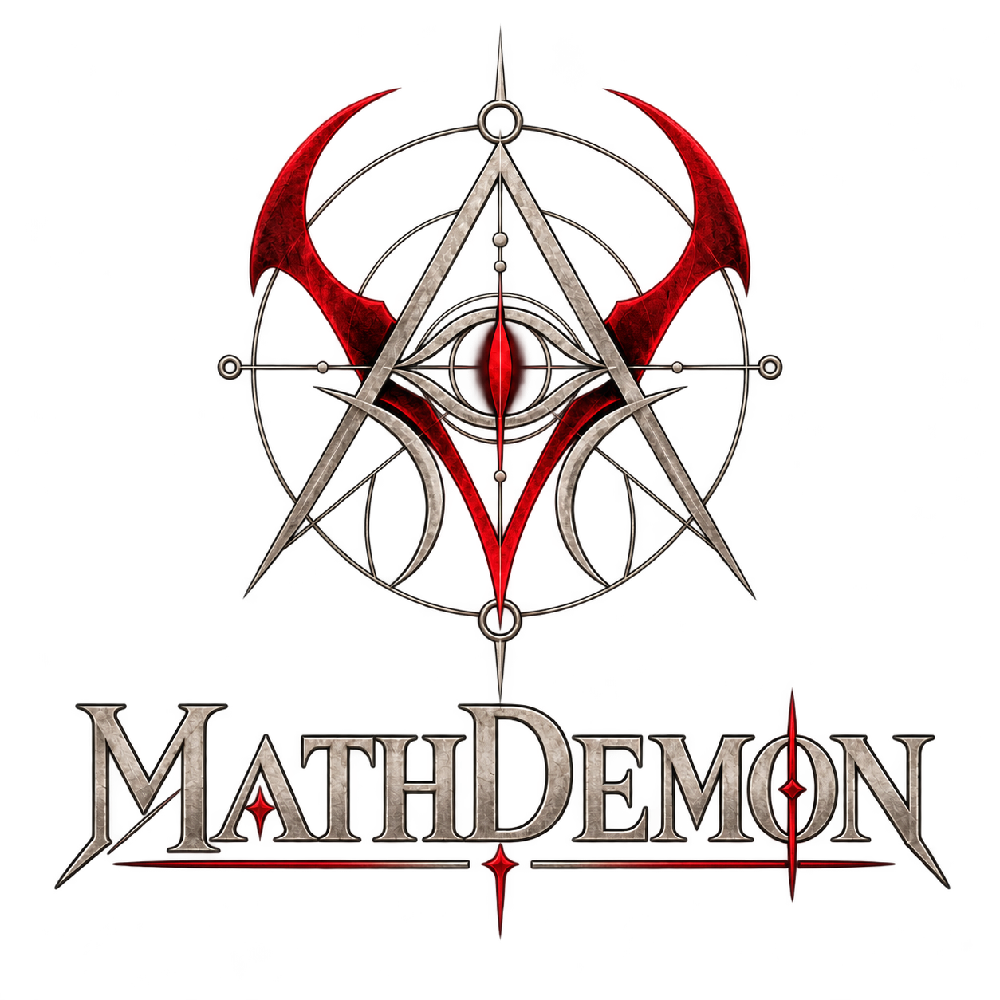

<p align="center">
  
</p>

<h1 align="center">MathDemon</h1>

<p align="center"><b>A free, open-source game for training mental arithmetic, working memory and mathematical logic.</b></p>

<p align="center"><b>▶ Play now: <a href="https://danielmartinscabanas.github.io/mathdemon/">danielmartinscabanas.github.io/mathdemon</a></b></p>

MathDemon throws a never-ending stream of math problems at you, each one a little harder than the last. You solve them in your head, type the answer, and climb a ladder of 36 ranks, from *Novice* to *The Absolute*. There is no level cap: problems keep growing in complexity for as long as you can keep up.

It is one single `index.html` file. [Play it online](https://danielmartinscabanas.github.io/mathdemon/), or download `index.html` and open it in a browser.

---

## Why this exists

The idea behind the project is simple: a small, distraction-free tool to practice **doing math in your head**. Holding several numbers and intermediate results in mind at once is a workout for **working memory**, and untangling a nested expression or an equation is a workout for **mathematical logic**. MathDemon is built around that loop: see a problem, think, answer, get immediate feedback, repeat.

## What you can practice

- **Arithmetic**: addition, subtraction, multiplication, exact division, and integer powers, with nested parentheses.
- **Linear equations**: solve for `x`.
- **Polynomial equations**: find every integer solution (type several answers separated by commas, e.g. `-2, 3`).

Difficulty is not just "bigger numbers". Each problem is built from a complexity budget that grows with your level: more operations, deeper nesting, richer operators, larger exponents, and more algebra, while the numbers themselves stay human-sized.

## How the game works

- **Skill and ranks**: every right answer raises your skill rating and every wrong answer lowers it, so your rank reflects the level you can really handle. There are 36 ranks in 6 tiers, and the last one is meant to be almost impossible to reach.
- **Every miss counts**: each wrong answer is logged in your history (with what you typed, never the solution) and costs skill.
- **Sacrifice**: give up a problem to see its answer and move on. It counts as a full defeat, and asks for confirmation so it can't be triggered by accident.
- **Streaks**: keep a streak going and the Streak box catches fire. Break it and the fire goes out.
- **Languages**: English and Brazilian Portuguese.
- **Music**: ambient background music in a loop, with an on/off button.
- **On-screen keypad**: digits, minus, comma, delete and submit, so you never fight the phone keyboard. A physical keyboard works too.
- **Mobile friendly**: responsive layout, and an install button for adding it to your phone's home screen.

## Privacy: 100% local, no data collection

MathDemon runs **entirely in your browser, on your device**.

- **No server.** There is no backend, no API, and no database.
- **No data collection.** No analytics, no tracking, no cookies, no accounts, no telemetry.
- **No network requests.** After the page loads, the game never talks to the internet. The only thing it stores is your own progress, kept on your device in the browser's local storage (`localStorage`). You can wipe it at any time with the **Reset progress** button, or by clearing your browser data.
- **No ads and no financial interest.** There is nothing to buy, nothing to sign up for, and no monetization of any kind. This project makes no money and is not trying to.

Because everything is local, you can save `index.html` to your computer and play it with no internet connection at all.

> **Note on the installable app:** the install button adds MathDemon to your home screen, but the page itself is still loaded from wherever it is hosted. The project deliberately has no service worker (that would need a second file). If you want guaranteed offline play, just save `index.html` and open it directly.

## Everything lives in `index.html`

Everything the game needs is **inside the single `index.html` file**:

- all the code (plain HTML, CSS and vanilla JavaScript, with no frameworks and no libraries)
- the **EB Garamond** fonts
- the logo, the favicon, the install icons and all 36 rank badges
- the background music

Images, fonts and audio are embedded as base64 data, so there is nothing to download, nothing to host next to it, and no external request of any kind. You can verify this: the page works with the network completely blocked.

### Project structure

The other folders are **only for source control**: they hold the original files so the assets can be rebuilt. The game does not need them to run.

```
index.html            <- the whole game. This is the only file you need.
rank-badges/          <- original rank badge images (36 PNGs)
logos/                <- original logo and icon images
songs/                <- the music files
tools/embed-assets.py <- script that turns the files above into base64 inside index.html
```

### Rebuilding the embedded assets

If you change an image or the song, re-embed everything with the script. It reads the original files, compresses them, converts them to base64 and rewrites only the `ASSETS` block of `index.html`. The original files are never modified.

```bash
pip install pillow                  # the only requirement
python3 tools/embed-assets.py       # rewrite the ASSETS block in index.html
python3 tools/embed-assets.py --check   # just report whether it is up to date
```

The music is picked from `songs/` (a file named `*-compressed.mp3` is preferred, since it is inlined as base64). To make a small one:

```bash
ffmpeg -i song.mp3 -map_metadata -1 -af volume=-3dB -c:a libmp3lame -b:a 64k song-compressed.mp3
```

## How the problems are generated

No machine learning and no pre-written problem lists. Problems are generated procedurally:

- Expressions are represented as **abstract syntax trees** and built from reusable operator rules.
- Generation is **backward**: the answer is chosen first, and an expression that evaluates to it is constructed from it.
- A **complexity budget** that grows with the level controls how hard each problem is, and a scoring function measures the real complexity of what was generated.
- Everything is computed with exact **BigInt** integer arithmetic, so there are no rounding errors, divisions are always exact, and every answer is validated independently of how the problem is displayed.
- Generation is deterministic: the same seed and settings always produce the same problems.

## Developer mode

Add `?dev` to the URL (for example `index.html?dev`) to open the developer tools: a debug panel (AST, complexity score, intermediate values, seed, tunable parameters) and an in-browser test suite that generates over a thousand problems and validates them automatically.

## Deploying to GitHub Pages

The live version is hosted on GitHub Pages at **https://danielmartinscabanas.github.io/mathdemon/**.

Since the game is a single static file, publishing it is easy: put `index.html` in the root of the repository, enable **GitHub Pages** in the repository settings, and you are done. No build step.

## Contributing

Contributions are welcome. Open an issue or a pull request. Keep these principles in mind: no runtime dependencies, no network requests, no tracking, and everything the game needs stays inside `index.html`.

## License

The source code is released under the [MIT License](LICENSE).

The MIT License covers the code. The EB Garamond font is used under the [SIL Open Font License](https://openfontlicense.org). The image and audio assets (logos, rank badges and music) are bundled for the game itself, so check their individual terms before reusing them on their own.
